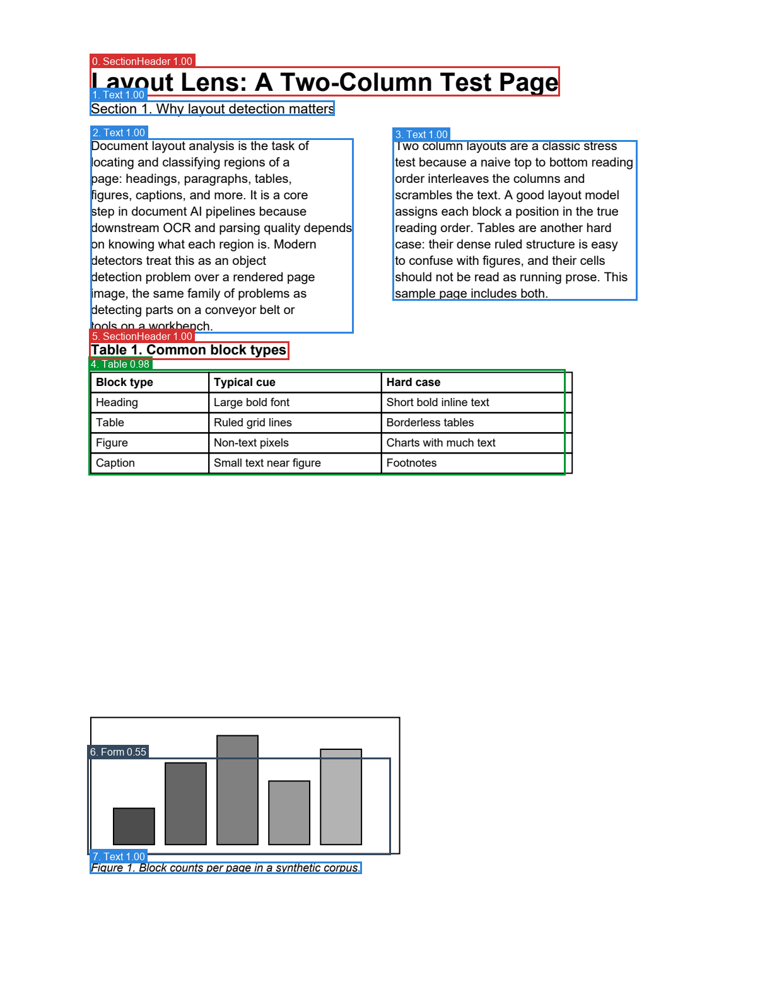

# layout-lens

A tiny CLI that runs [Surya](https://github.com/datalab-to/surya) layout
detection (from [Datalab](https://www.datalab.to/), the team behind Marker)
on a PDF page and renders an annotated image of every detected block with
its label, reading-order position, and confidence, plus a console report.

Everything runs locally on CPU. No API keys. The repo is self-contained:
the sample PDF is generated in-repo with reportlab.



## Quickstart

```
pip install -r requirements.txt
python make_sample.py                 # writes sample.pdf (two columns, table, figure)
python layout_lens.py sample.pdf      # writes annotated.png + console report
```

Surya downloads its model weights from Hugging Face on the first run
(free, no account or key needed). First run on CPU takes a few minutes;
after the download, inference itself is the only cost.

There is also a zero-ML fallback engine if you want to compare against a
dumb heuristic: `python layout_lens.py sample.pdf --engine pdfplumber`.

## Real output

Actual console output from running `python layout_lens.py sample.pdf` on
this machine (Windows 11, CPU only, surya-ocr 0.14.7):

```
engine: surya | 32.8s | 8 blocks detected

Blocks by type:
  Text           4
  SectionHeader  2
  Table          1
  Form           1

Reading order:
   0. SectionHeader  conf=1.00  bbox=( 142, 106, 888, 153)
   1. Text           conf=1.00  bbox=( 142, 159, 531, 184)
   2. Text           conf=1.00  bbox=( 143, 219, 560, 528)
   3. Text           conf=1.00  bbox=( 623, 222,1011, 477)
   4. Table          conf=0.98  bbox=( 140, 586, 897, 753)
   5. SectionHeader  conf=1.00  bbox=( 142, 542, 458, 570)
   6. Form           conf=0.55  bbox=( 139,1201, 619,1355)
   7. Text           conf=1.00  bbox=( 143,1367, 574,1386)

annotated image written to annotated.png
```

The 32.8s includes the one-time model download; a warm run is a few
seconds of CPU inference for the page.

## What the detector got right / missed

Right:

- Both columns come out as separate Text blocks with correct
  left-then-right reading order (positions 2 and 3) - the exact failure
  mode a naive top-to-bottom sort would hit.
- The table is detected as Table at 0.98 with a tight box.
- The title and the "Table 1." label are both classified SectionHeader.

Missed:

- The bar chart is labeled Form at 0.55 instead of Figure, and its box
  covers only part of the chart. Low confidence flagging a wrong call is
  the behavior you want, but it is still a miss. A vector-drawn chart
  with no raster pixels is a fair stress case.
- Its caption comes out as Text rather than Caption.
- Minor reading-order quirk: the "Table 1." header (position 5) is
  ordered after the table body (position 4) instead of before it.

## A note on versions

This demo pins `surya-ocr==0.14.7`, the last line of releases where layout
inference runs directly in PyTorch. Surya 0.20+ (Surya 2) moved inference
behind a `llama-server` backend, which needs a separate llama.cpp binary
installed - great for serving, but it breaks the "pip install and run"
promise of a small demo, so I pinned the torch-native version and I'm
saying so here rather than pretending otherwise.

## Why I built this

I'm Muhammad Abdulrehman, a Drexel CS student. I train detection models
(YOLO, RF-DETR) daily for a robot-arm vision pipeline at Drexel's McDonald
Lab - layout detection is the same problem family: draw tight boxes around
the things that matter, classify them, and get the ordering right.
